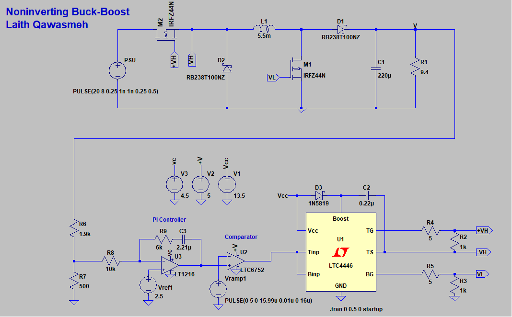
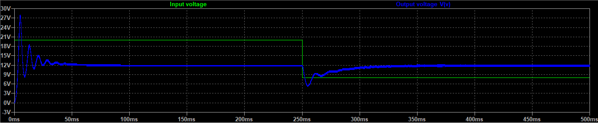
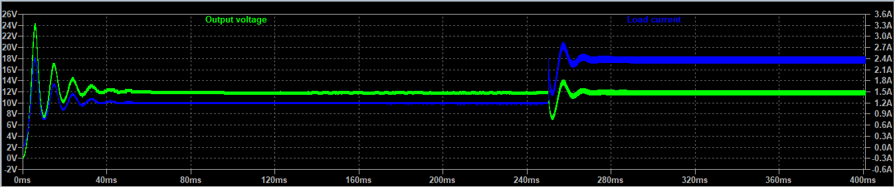

# Closed-Loop Non-Inverting Buck-Boost DC-DC Converter (LTspice)

[](https://opensource.org/licenses/MIT)
[](https://www.analog.com/en/resources/design-tools-and-calculators/ltspice-simulator.html)
[](#)
[](#)
[](#)

A high-fidelity, closed-loop **Non-Inverting Buck-Boost DC-DC Converter** designed and simulated in **LTspice**. 

This power converter accepts a wide input voltage range of **$8\text{ V}$ to $20\text{ V}$** and regulates a tightly stabilized **$12.0\text{ V}$ DC** output across varying line and load conditions. The system incorporates an analog **Proportional-Integral (PI)** error amplifier, high-speed PWM comparator, and a dedicated **LTC4446** high-voltage bootstrap MOSFET gate driver.

Designed by **Laith Qawasmeh** (M.Sc. Electrical Engineering | Power Electronics & Embedded Systems).

---

## Table of Contents
1. [Overview & Motivation](#overview--motivation)
2. [Schematic Architecture](#schematic-architecture)
3. [Design Specifications](#design-specifications)
4. [Mathematical Modeling & Component Sizing](#mathematical-modeling--component-sizing)
5. [Subsystems & Circuit Operation](#subsystems--circuit-operation)
6. [Simulation Results & Verification](#simulation-results--verification)
   - [Dynamic Line Regulation (8V - 20V Step)](#1-dynamic-line-regulation-8v---20v-step)
   - [Dynamic Load Regulation Transient](#2-dynamic-load-regulation-transient)
7. [Bill of Materials (BOM)](#bill-of-materials-bom)
8. [Getting Started & Simulation Guide](#getting-started--simulation-guide)
9. [Repository Structure](#repository-structure)
10. [Citation & License](#citation--license)

---

## Overview & Motivation

Conventional buck-boost converters invert the polarity of the output voltage ($V_{out} < 0\text{ V}$), which complicates grounding schemes, sensing circuitry, and system-level integration. In contrast, the **two-switch non-inverting buck-boost topology** cascaded with an intermediate inductor delivers positive regulated output voltage ($V_{out} > 0\text{ V}$) regardless of whether the input voltage is higher than, equal to, or lower than the output:

- **$V_{in} > V_{out}$ ($20\text{ V} \to 12\text{ V}$):** Operates in the **Buck** regime ($D < 0.5$).
- **$V_{in} = V_{out}$ ($12\text{ V} \to 12\text{ V}$):** Operates at unitary conversion ($D = 0.5$).
- **$V_{in} < V_{out}$ ($8\text{ V} \to 12\text{ V}$):** Operates in the **Boost** regime ($D > 0.5$).

### Key Applications
- **Automotive Electronics:** Maintaining a stable $12\text{ V}$ bus through cold cranking ($V_{in} \sim 6\text{ V}-8\text{ V}$), nominal operation ($12\text{ V}-14.4\text{ V}$), and load dump transients ($V_{in} > 20\text{ V}$).
- **Battery-Powered Systems & Energy Storage:** Squeezing maximum energy out of multi-cell Li-Ion batteries as cell voltage drops during discharge.
- **Solar PV / Renewable Micro-power:** Regulating variable photovoltaic panel outputs to a fixed bus voltage.

---

## Schematic Architecture

The complete LTspice simulation schematic incorporates the power stage, closed-loop feedback divider, analog PI controller, sawtooth PWM modulator, and high-side bootstrap gate driver:



*Figure 1: Complete closed-loop Non-Inverting Buck-Boost Converter schematic in LTspice.*

---

## Design Specifications

| Parameter | Symbol | Value | Unit | Description / Condition |
| :--- | :---: | :---: | :---: | :--- |
| **Input Voltage Range** | $V_{in}$ | $8.0 - 20.0$ | $\text{V}$ | Line transient tested between $8\text{ V}$ and $20\text{ V}$ |
| **Nominal Output Voltage** | $V_{out}$ | $12.0$ | $\text{V}$ | Regulated target output |
| **Switching Frequency** | $f_{sw}$ | $62.5$ | $\text{kHz}$ | $T_{sw} = 16.0\ \mu\text{s}$ |
| **Nominal Load Resistance** | $R_L$ | $9.4$ | $\Omega$ | Load resistor $R_1$ |
| **Nominal Load Current** | $I_{out}$ | $\approx 1.28$ | $\text{A}$ | $I_{out} = V_{out} / R_L = 12\text{ V} / 9.4\ \Omega$ |
| **Nominal Output Power** | $P_{out}$ | $\approx 15.3$ | $\text{W}$ | Continuous conduction power level |
| **Max Inductor Current Ripple** | $\Delta I_L$ | $< 50$ | $\text{mA}$ | Ultra-low ripple, continuous conduction mode (CCM) |
| **Max Output Voltage Ripple** | $\Delta V_{out}$ | $< 100$ | $\text{mV}$ | Filtered capacitor ripple target |
| **Main Inductance** | $L_1$ | $5.5$ | $\text{mH}$ | With series resistance $R_{ser} = 10\text{ m}\Omega$ |
| **Output Filter Capacitance**| $C_1$ | $220$ | $\mu\text{F}$ | With series resistance $R_{ser} = 100\text{ m}\Omega$ |
| **Reference Voltage** | $V_{ref1}$ | $2.50$ | $\text{V}$ | Precision error amplifier reference |

---

## Mathematical Modeling & Component Sizing

### 1. Conversion Transfer Function & Duty Cycle
For a simultaneous two-switch non-inverting buck-boost converter where high-side switch $M_2$ and low-side switch $M_1$ are driven synchronously by duty cycle $D$:

$$V_{out} = V_{in} \cdot \frac{D}{1 - D}$$

Solving for the duty cycle $D$ as a function of $V_{in}$ and $V_{out}$:

$$D = \frac{V_{out}}{V_{in} + V_{out}}$$

- **At Maximum Input Voltage ($V_{in} = 20\text{ V}$, Buck Regime):**
  $$D_{min} = \frac{12}{20 + 12} = \frac{12}{32} = 0.375 \quad (37.5\%)$$
- **At Nominal Voltage ($V_{in} = 12\text{ V}$, Unitary Regime):**
  $$D_{nom} = \frac{12}{12 + 12} = \frac{12}{24} = 0.500 \quad (50.0\%)$$
- **At Minimum Input Voltage ($V_{in} = 8\text{ V}$, Boost Regime):**
  $$D_{max} = \frac{12}{8 + 12} = \frac{12}{20} = 0.600 \quad (60.0\%)$$

---

### 2. Inductor Sizing ($L_1$)
During the ON-time ($t_{on} = D \cdot T_{sw}$), the input voltage is applied directly across the inductor:

$$\Delta I_L = \frac{V_{in} \cdot D}{f_{sw} \cdot L_1}$$

Using the chosen inductance $L_1 = 5.5\text{ mH}$ at $f_{sw} = 62.5\text{ kHz}$:

- **At $V_{in} = 20\text{ V}$ ($D = 0.375$):**
  $$\Delta I_L = \frac{20 \times 0.375}{62500 \times 0.0055} = \frac{7.5}{343.75} \approx 21.82\text{ mA}$$
- **At $V_{in} = 8\text{ V}$ ($D = 0.60$):**
  $$\Delta I_L = \frac{8 \times 0.60}{62500 \times 0.0055} = \frac{4.8}{343.75} \approx 13.96\text{ mA}$$

Both ripple values are well below the target limit of $\mathbf{50\text{ mA}}$, guaranteeing continuous conduction mode (CCM) with negligible current ripple and low core loss.

---

### 3. Output Filter Capacitor Sizing ($C_1$)
During the switch ON-time, diode $D_1$ is reverse-biased, and output capacitor $C_1$ supplies the entirety of the load current $I_{out}$:

$$\Delta V_{C} = \frac{I_{out} \cdot D}{f_{sw} \cdot C_1}$$

Evaluating at worst-case duty cycle ($D_{max} = 0.60$ at $V_{in} = 8\text{ V}$) with $C_1 = 220\ \mu\text{F}$ and $I_{out} = 1.28\text{ A}$:

$$\Delta V_{C} = \frac{1.28 \times 0.60}{62500 \times 220 \times 10^{-6}} = \frac{0.768}{13.75} \approx 55.85\text{ mV}$$

This comfortably fulfills the design ripple criterion of $\mathbf{\Delta V_{out} < 100\text{ mV}}$.

---

### 4. Feedback Divider Network
To compare the $12\text{ V}$ output with the precision $2.50\text{ V}$ reference, the feedback divider is sized as follows:

$$V_{fb} = V_{out} \cdot \frac{R_7}{R_6 + R_7} = 12.0\text{ V} \cdot \frac{500\ \Omega}{1900\ \Omega + 500\ \Omega} = 12.0 \cdot \frac{500}{2400} = 2.50\text{ V}$$

The divider impedance is optimized to balance noise immunity against quiescent divider current ($\approx 5\text{ mA}$).

---

### 5. Analog PI Compensator Transfer Function
The error amplifier utilizes an ultra-fast **LT1216** operational amplifier configured in an inverting Type-II / PI arrangement with series resistor-capacitor feedback ($R_9, C_3$) and input resistor $R_8$:

$$G_c(s) = -\frac{Z_f(s)}{Z_{in}(s)} = -\frac{R_9 + \frac{1}{s C_3}}{R_8} = -\left( \frac{R_9}{R_8} + \frac{1}{s R_8 C_3} \right) = -K_p \left( 1 + \frac{1}{s T_i} \right)$$

- **Proportional Gain ($K_p$):**
  $$K_p = \frac{R_9}{R_8} = \frac{6.0\text{ k}\Omega}{10.0\text{ k}\Omega} = 0.60 \quad (-4.44\text{ dB})$$
- **Integral Gain ($K_i$):**
  $$K_i = \frac{1}{R_8 C_3} = \frac{1}{10^4 \cdot 2.21 \times 10^{-6}} \approx 45.25\text{ s}^{-1}$$
- **Compensator Zero Frequency ($f_z$):**
  $$f_z = \frac{1}{2\pi R_9 C_3} = \frac{1}{2\pi \times 6000\ \Omega \times 2.21\ \mu\text{F}} \approx 12.0\text{ Hz}$$

The low-frequency zero provides phase boost to compensate for the plant's low-frequency phase lag while maintaining infinite DC gain for zero steady-state error.

---

## Subsystems & Circuit Operation

1. **Power Stage:**
   - **High-side Buck Switch $M_2$ (IRFZ44N):** Interrupts input current from $V_{in}$ (node PSU).
   - **Freewheeling Diode $D_2$ (RB238T100NZ):** Ultra-fast Schottky diode maintaining inductor current continuity when $M_2$ turns off.
   - **Energy Storage Inductor $L_1$ ($5.5\text{ mH}$):** Transfers energy between buck and boost stages.
   - **Low-side Boost Switch $M_1$ (IRFZ44N):** Shunts the inductor node to ground during ON-time to store energy.
   - **Output Rectifier Diode $D_1$ (RB238T100NZ):** Delivers inductor current to output filter during OFF-time.
   - **Filter Capacitor $C_1$ ($220\ \mu\text{F}$):** Smooths switching ripple to under $100\text{ mV}$.

2. **PWM Carrier & Comparator:**
   - **Sawtooth Carrier ($V_{ramp1}$):** $0\text{ V}$ to $5\text{ V}$ linear ramp with $15.99\ \mu\text{s}$ rise time and $0.01\ \mu\text{s}$ flyback ($f_{sw} = 62.5\text{ kHz}$).
   - **Comparator ($U_2$ - LTC6752):** High-speed $280\text{ MHz}$ comparator generating crisp PWM pulses by comparing the PI control voltage $v_c$ against $V_{ramp1}$.

3. **MOSFET Driver Subsystem ($U_1$ - LTC4446):**
   - High-voltage gate driver capable of driving high-side N-channel MOSFETs up to $100\text{ V}$.
   - **Bootstrap Rail:** Formed by diode $D_3$ (1N5819) and high-quality ceramic capacitor $C_2$ ($0.22\ \mu\text{F}$, $50\text{ V}$). The bootstrap capacitor charges to $V_{cc} = 13.5\text{ V}$ when node TS is pulled low, providing the floating bias $(+VH, -VH)$ needed to drive high-side switch $M_2$.
   - **Gate Damping:** $5\ \Omega$ gate resistors ($R_4, R_5$) limit $di/dt$ and ringing, while $1\text{ k}\Omega$ pull-down resistors ($R_2, R_3$) ensure default off-states.

---

## Simulation Results & Verification

### 1. Dynamic Line Regulation (8V - 20V Step)

The converter's closed-loop rejection against severe supply line variations was verified by applying a dynamic step input from **$20\text{ V}$ down to $8\text{ V}$** at $t = 250\text{ ms}$:



*Figure 2: Transient response under dynamic input voltage step.*

#### Waveform Analysis:
- **Startup ($0 - 50\text{ ms}$):** The converter starts up from $0\text{ V}$ with initial damping and settles cleanly to $12.0\text{ V}$ DC regulation within $50\text{ ms}$.
- **Buck Operation ($0 - 250\text{ ms}$, $V_{in} = 20\text{ V}$):** Output voltage remains locked at exactly $12.0\text{ V}$ with minimal ripple.
- **Line Step Transient ($t = 250\text{ ms}$):** When $V_{in}$ suddenly drops from $20\text{ V}$ to $8\text{ V}$, the output experiences a brief dip to $\sim 6\text{ V}$.
- **Boost Recovery ($250\text{ ms} - 350\text{ ms}$):** The analog PI integrator automatically increases the control voltage $v_c$, boosting the duty cycle from $37.5\%$ to $60\%$. Within $\sim 100\text{ ms}$, the converter fully recovers and locks back onto the regulated $12.0\text{ V}$ rail.

---

### 2. Dynamic Load Regulation Transient

The converter's transient stability and output impedance were validated under a dynamic load current step:



*Figure 3: Output voltage response under a step increase in load current.*

#### Waveform Analysis:
- **Nominal Loading ($0 - 250\text{ ms}$):** Load current is $\approx 1.28\text{ A}$ ($R_L = 9.4\ \Omega$), with output voltage stable at $12.0\text{ V}$.
- **Load Step at $t = 250\text{ ms}$:** Load current jumps from $1.28\text{ A}$ to $2.4\text{ A}$ (nearly double the load).
- **Dynamic Compensation:** The closed-loop controller reacts instantaneously to suppress the transient undershoot, damping out oscillations and restoring tight $12.0\text{ V}$ regulation under full heavy load.

---

## Bill of Materials (BOM)

| Designator | Description | Model / Part Number | Value / Ratings | Package / Role |
| :--- | :--- | :--- | :--- | :--- |
| **$M_1$** | N-Channel Power MOSFET | IRFZ44N | $55\text{ V}, 49\text{ A}, 17.5\text{ m}\Omega$ | Low-side boost switch |
| **$M_2$** | N-Channel Power MOSFET | IRFZ44N | $55\text{ V}, 49\text{ A}, 17.5\text{ m}\Omega$ | High-side buck switch |
| **$D_1$** | Schottky Barrier Diode | RB238T100NZ | $100\text{ V}, 40\text{ A}$ | Output boost rectifier diode |
| **$D_2$** | Schottky Barrier Diode | RB238T100NZ | $100\text{ V}, 40\text{ A}$ | Buck freewheeling diode |
| **$D_3$** | Schottky Diode | 1N5819 | $40\text{ V}, 1\text{ A}$ | Bootstrap charging diode |
| **$L_1$** | Power Inductor | Custom | $5.5\text{ mH}, R_{ser} = 10\text{ m}\Omega$ | Main energy storage inductor |
| **$C_1$** | Electrolytic/Polymer Cap | Custom | $220\ \mu\text{F}, R_{ser} = 100\text{ m}\Omega$ | Output filter capacitor |
| **$C_2$** | Ceramic Capacitor | KEMET C1825C224K5RAC | $0.22\ \mu\text{F}, 50\text{ V}, \text{X7R}$ | High-side bootstrap capacitor |
| **$C_3$** | Film / Ceramic Capacitor | Custom | $2.21\ \mu\text{F}$ | PI compensator feedback capacitor |
| **$U_1$** | High/Low Side MOSFET Driver | LTC4446 | $100\text{ V}$ High Voltage Driver | Gate driver IC |
| **$U_2$** | High-Speed Comparator | LTC6752 | $280\text{ MHz}, 2.9\text{ ns}$ Delay | PWM modulator comparator |
| **$U_3$** | High-Speed Operational Amp | LT1216 | $180\text{ MHz}$ Rail-to-Rail | Closed-loop error amplifier |
| **$R_1$** | Power Load Resistor | Power Resistor | $9.4\ \Omega, >25\text{ W}$ | Main DC output load |
| **$R_2, R_3$** | Pull-down Resistors | Metal Film | $1.0\text{ k}\Omega, 0.25\text{ W}$ | Driver gate discharge pull-downs |
| **$R_4, R_5$** | Gate Resistors | Metal Film | $5.0\ \Omega, 0.25\text{ W}$ | High & Low side gate damping |
| **$R_6$** | Feedback Upper Resistor | Precision Resistor (1%) | $1.9\text{ k}\Omega, 0.25\text{ W}$ | Voltage divider top |
| **$R_7$** | Feedback Lower Resistor | Precision Resistor (1%) | $500\ \Omega, 0.25\text{ W}$ | Voltage divider bottom |
| **$R_8$** | PI Input Resistor | Precision Resistor (1%) | $10.0\text{ k}\Omega, 0.25\text{ W}$ | Error amplifier input resistor |
| **$R_9$** | PI Feedback Resistor | Precision Resistor (1%) | $6.0\text{ k}\Omega, 0.25\text{ W}$ | Error amplifier zero-setting resistor |
| **$V_1$** | Auxiliary DC Supply | DC Voltage Source | $13.5\text{ V}$ | Gate driver supply rail ($V_{cc}$) |
| **$V_2$** | Logic DC Supply | DC Voltage Source | $5.0\text{ V}$ | Comparator logic supply rail ($+V$) |
| **$V_3$** | Op-Amp DC Supply | DC Voltage Source | $4.5\text{ V}$ | Op-amp supply rail ($-v_c$) |
| **$V_{ref1}$** | Voltage Reference Source | Precision Reference | $2.50\text{ V}$ | Control loop reference voltage |
| **$V_{ramp1}$** | Sawtooth Pulse Source | Pulse Source | $0-5\text{ V}, 16\ \mu\text{s}$ period | $62.5\text{ kHz}$ PWM ramp generator |

---

## Getting Started & Simulation Guide

### Prerequisites
- **LTspice XVII** or **LTspice 24** (Freely available for Windows and macOS from [Analog Devices](https://www.analog.com/en/resources/design-tools-and-calculators/ltspice-simulator.html)).
- All active components (`IRFZ44N`, `LTC4446`, `LTC6752`, `LT1216`, `1N5819`) use standard built-in or native SPICE macromodels included with standard LTspice distributions.

### Running the Simulation
1. Clone this repository:
   ```bash
   git clone https://github.com/laith0442-dev/noninverting-buck-boost-converter-ltspice.git
   cd noninverting-buck-boost-converter-ltspice
   ```
2. Double-click or open `Noninverting_Buck_Boost_Converter_project_LTspice.asc` in LTspice.
3. Click the **Run** (Running Man) button on the toolbar (or press `Alt + R`).
4. The simulation is pre-configured with:
   ```spice
   .tran 0 0.5 0 startup
   ```
   Simulating $500\text{ ms}$ of transient behavior takes approximately $15 - 30$ seconds depending on CPU speed.

### Recommended Signal Probes
- **Output Voltage:** Click on node `V` to plot $V_{out}(t)$.
- **Input Line Voltage:** Click on node `PSU` to plot $V_{in}(t)$.
- **Load Current:** Alt-click resistor `R1` to plot $I(R1)$.
- **Control Voltage & PWM:** Plot $V(vc)$ and compare with $V(vramp1)$ at comparator $U_2$.
- **High-Side Floating Gate Drive:** Measure differential voltage between $+VH$ and $-VH$ (`V(+VH, -VH)`).

---

## Repository Structure

```text
noninverting-buck-boost-converter-ltspice/
├── Noninverting_Buck_Boost_Converter_project_LTspice.asc   # Primary LTspice schematic file
├── design_parameters.txt                                  # Sizing specifications and parameters
├── docs/
│   └── images/
│       ├── circuit_schematic.png                          # Annotated LTspice schematic diagram
│       ├── line_regulation_transient.png                  # Vin step response waveform (20V -> 8V)
│       └── load_regulation_transient.png                  # Load current transient response waveform
├── .gitignore                                             # LTspice simulation artifacts ignore rules
├── LICENSE                                                # MIT Open-Source License
├── CITATION.cff                                           # Citation Metadata
├── CONTRIBUTING.md                                        # Contribution guidelines
└── README.md                                              # Project documentation & analysis
```

---

## Citation & License

### Author
**Laith Qawasmeh**  
*M.Sc. Electrical Engineering | Power Electronics | Embedded Systems | MATLAB | Python*  
GitHub: [@laith0442-dev](https://github.com/laith0442-dev)

### License
This project is open-source hardware and software simulation distributed under the **[MIT License](LICENSE)**. Feel free to use, study, modify, and integrate it into academic research or industrial designs.
